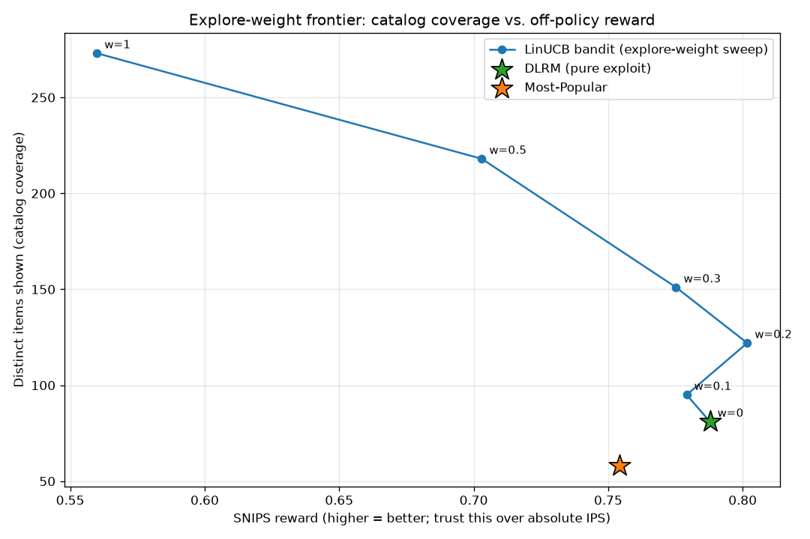

# 🎬 RecommenderSystem

[](https://www.python.org/)
[](https://fastapi.tiangolo.com/)
[](https://pytorch.org/)
[](https://www.docker.com/)
[](https://github.com/AkinCodes/RecommenderSystem/actions/workflows/ci.yml)

A movie-recommendation API serving a Deep Learning Recommendation Model (DLRM) with a two-stage retrieval pipeline and a contextual-bandit exploration layer.

**Serving numbers (real, reproducible):**

- **~0.06 ms/user** DLRM inference (PyTorch, batch-1) → **~0.01 ms/user** with ONNX Runtime (**5.7× faster** on CPU, validated <1e-5 parity); **~1 ms** Faiss candidate generation over 1,682 items. Reproducible via `scripts/export_onnx.py` + `scripts/benchmark_inference.py` → [BENCHMARK.md](BENCHMARK.md).
- **Docker-ready with a `/health` check**, and built as the backend for a SwiftUI iOS app. It ran on Render's free tier; hosting is paused for now (see [Deployment](#deployment)).
- **+51% catalog coverage** (81 → 122 distinct items) at the served explore weight `w=0.2` while **matching DLRM reward** (SNIPS 0.802 vs 0.788) — off-policy evaluated on 20K replay events.
- **147 tests passing, 0 errors** — `uv run pytest` (Python 3.12). See [Tests](#tests).

**Model quality (MovieLens 100K, matched 3-way split, seeded, 283 held-out users):**

- **DLRM NDCG@10 = 0.7861**, AUC = 0.6762 — evaluated with the fixed per-candidate scoring (see the [eval-rigor war story](docs/blog/eval-rigor-war-story.md)).
- Paired significance testing: the DLRM **significantly beats** XGBoost (p = 0.003) and LightGBM (p = 0.0004), and is a **statistical tie** with a well-scaled LogReg baseline (Δ = +0.0076, 95% CI [−0.0027, +0.0175], p = 0.14). Every claim is backed by a bootstrap CI, not a bare point estimate.

**Stack:** PyTorch DLRM · FastAPI · Faiss ANN retrieval · LinUCB contextual bandit (online learning + off-policy eval) · ONNX export · Docker · live TMDB enrichment. You send preferences, it runs a neural forward pass, pulls real movie data from TMDB (posters, ratings, summaries), and returns personalized, exploration-aware recommendations.

---

## Quick Demo (run it locally)

Hosting is paused for now, so the quickest way to try it is on your own machine. You'll need a free TMDB API key (see [Getting Started](#getting-started)):

```bash
git clone https://github.com/AkinCodes/RecommenderSystem.git && cd RecommenderSystem
make install
cp .env.example .env   # then add TMDB_API_KEY and TMDB_BEARER_TOKEN
make run
```

Then, in another terminal:

```bash
curl -X POST http://localhost:8000/api/v1/predict \
  -H "Content-Type: application/json" \
  -d '{"continuous_features": [0.76, 0.5, 0.3, 0.4, 0.72, 0.6, 0.8, 0.52], "categorical_features": [1, 2]}'
```

You'll get something like this:

```json
[
  {
    "title": "The Shawshank Redemption",
    "genre": "Unknown",
    "rating": "N/A",
    "score": 0.87,
    "poster_url": "https://image.tmdb.org/t/p/w500/q6y0Go1tsGEsmtFryDOJo3dEmqu.jpg",
    "director": "N/A",
    "release_year": 1994,
    "summary": "Imprisoned in the 1940s for the double murder of his wife and her lover..."
  },
  {
    "title": "Interstellar",
    "genre": "Unknown",
    "rating": "N/A",
    "score": 0.84,
    "poster_url": "https://image.tmdb.org/t/p/w500/gEU2QniE6E77NI6lCU6MxlNBvIx.jpg",
    "director": "N/A",
    "release_year": 2014,
    "summary": "The adventures of a group of explorers who make use of a newly discovered wormhole..."
  }
]
```

Five movies, ranked by how well they match your taste profile, each with a poster URL you can render directly in a client app.

---

## How It Works

```
┌─────────────────────────────────────────────────────────────────────┐
│                         CLIENT REQUEST                              │
│  POST /api/v1/predict                                               │
│  { "continuous_features": [0.76, 0.5, 0.3, 0.4, 0.72, 0.6, 0.8, 0.52],│
│    "categorical_features": [1, 2] }                                 │
└──────────────────────────┬──────────────────────────────────────────┘
                           │
                           ▼
┌─────────────────────────────────────────────────────────────────────┐
│                      INPUT VALIDATION                               │
│  Pydantic checks types + FastAPI validates feature counts           │
└──────────────────────────┬──────────────────────────────────────────┘
                           │
                           ▼
┌─────────────────────────────────────────────────────────────────────┐
│                       DLRM MODEL (PyTorch)                          │
│                                                                     │
│  continuous features ──► Dense Layer ──────────┐                    │
│                                                 ├──► MLP ──► Score  │
│  categorical features ──► Embedding Tables ────┘    [128→64→32→1]  │
│                                                      + Sigmoid      │
│                                                      → [0.0, 1.0]  │
└──────────────────────────┬──────────────────────────────────────────┘
                           │
                           ▼
┌─────────────────────────────────────────────────────────────────────┐
│                     TMDB API (async via httpx)                      │
│  Fetches popular movies: titles, ratings, poster paths, summaries   │
└──────────────────────────┬──────────────────────────────────────────┘
                           │
                           ▼
┌─────────────────────────────────────────────────────────────────────┐
│                       RANKING + RESPONSE                            │
│  Sorts movies by how closely they match the prediction score        │
│  Returns top 5 with full metadata + poster URLs                     │
└─────────────────────────────────────────────────────────────────────┘
```

**Step by step:**

1. **You send preferences** — 8 continuous features (engineered stats like average rating, activity, item popularity) and 2 categorical features (user ID and item ID).
2. **DLRM processes them** — the model takes your 8 continuous features through a dense layer and your category choices through separate embedding tables (`[943, 1682]`, each 64-dim). It also computes an element-wise user × item interaction (the two embedding vectors multiplied together). Everything gets concatenated and pushed through a multi-layer perceptron (128 → 64 → 32 neurons) with Dropout(0.2) that outputs a single score between 0 and 1.
3. **Real movies get fetched** — the API calls TMDB asynchronously to grab currently popular movies with their metadata.
4. **Results get ranked** — movies are sorted by how well their TMDB rating aligns with the model's prediction score, and the top 5 are returned with titles, posters, release years, and summaries.

---

## Features

### The Model

The DLRM (Deep Learning Recommendation Model) is built from scratch in PyTorch. What makes it interesting:

- **Handles mixed feature types** — 8 continuous features (engineered user/item stats) go through a dense layer, while categorical features (user ID, item ID) each get their own embedding table. This is how real recommendation systems at companies like Meta handle the mix of "how much" and "which one" data.
- **Embedding tables** — `[943, 1682]` — two embedding tables (users, items), each 64-dimensional (`embedding_dim`, decoupled from the MLP widths).
- **Explicit feature interaction** — computes element-wise user × item embedding product before the MLP, capturing direct collaborative filtering signal.
- **MLP interaction layer** — a 3-layer network (128 → 64 → 32) with ReLU activations and Dropout(0.2) that learns how continuous features, embeddings, and their interaction combine.
- **Binary classification** — ratings >= 4 are positive, trained with BCELoss. Sigmoid output produces a score between 0 and 1.
- **Regularization** — Dropout(0.2), weight decay (1e-5), early stopping (patience=5) driven by a held-out **validation** split, not the training loss — so it stops at the checkpoint that generalizes best, not the most-overfit one.
- **Input validation** — the forward pass checks for None inputs, mismatched feature counts, and MLP shape mismatches, raising clear errors instead of crashing silently.

### Exploration & Online Learning

The recommender doesn't only exploit what the DLRM already knows — it can explore.

- **Contextual bandit (LinUCB)** — `/api/v1/recommend_v3` reranks candidates by a common-scale blend of the DLRM score and a LinUCB exploration bonus, tuned by a single explore-weight `w` (default `0.2`). This surfaces items the model is *unsure* about instead of only its safest bets. See [Exploration layer](#exploration-layer-contextual-bandit).
- **Online learning** — `POST /api/v1/feedback` updates the bandit from observed rewards and atomically persists its state, so the policy improves after deployment without retraining the DLRM.
- **Off-policy evaluation** — the layer is validated on logged data with replay + IPS/SNIPS estimators and an explore-weight coverage/reward frontier, not just asserted to work.

### Real Movie Data

- **TMDB integration** — fetches currently popular movies from The Movie Database API, so recommendations always reflect what's actually out there.
- **Async fetching** — uses `httpx.AsyncClient` so the API doesn't block while waiting on TMDB.
- **Full metadata** — each recommendation comes with title, rating, poster URL (ready to render in a UI), release year, and a plot summary.

### API Design

- **Versioned endpoints** — `/api/v1/predict` with a legacy `/predict/` that delegates to it for backward compatibility.
- **Health checks** — `GET /health` reports model status, app version, and whether everything is loaded.
- **Model introspection** — `GET /api/v1/models` returns architecture details, parameter count, device info, and layer configuration.
- **Structured errors** — every error (400, 404, 422, 500, 502, 503) returns consistent JSON with `success`, `error`, and `detail` fields. No raw stack traces in production.
- **Request logging middleware** — every request gets logged with method, path, status code, and duration in milliseconds.

### Developer Experience

- **Makefile** — one command for anything: `make run`, `make test`, `make lint`, `make docker-build`.
- **uv for dependency management** — fast, reproducible installs via `pyproject.toml`.
- **Docker with health checks** — production Dockerfile includes a `HEALTHCHECK` directive that pings `/health` every 30 seconds.
- **Comprehensive tests** — 147 tests covering model forward passes, API endpoints, input validation, edge cases (empty batches, wrong types, missing fields), structured error responses, preprocessing config, DLRM interaction verification, plus the bandit math (Sherman-Morrison updates, scale-invariant blending), off-policy estimators (replay/IPS/SNIPS against synthetic ground truth), and exploration ordering effects.
- **Ruff for linting** — fast Python linting and formatting with a 120-char line length.

---

## Tech Stack

| Technology | Why |
|---|---|
| **PyTorch** | Full control over the DLRM architecture — custom forward pass, manual embedding tables, easy to extend |
| **FastAPI** | Async by default, automatic OpenAPI docs, Pydantic validation on every request, and it's fast |
| **httpx** | Async HTTP client for non-blocking TMDB API calls inside async FastAPI endpoints |
| **uv** | 10-100x faster than pip for dependency resolution and installs |
| **Pydantic** | Type-safe request/response schemas that auto-generate API documentation |
| **Docker** | Consistent environment from dev to production, with multi-stage builds and health checks |
| **Ruff** | Linting + formatting in one tool, written in Rust, runs in milliseconds |
| **pytest** | Test framework with fixtures, parametrize, and async support for testing FastAPI endpoints |
| **Faiss** | Approximate nearest-neighbor search for fast candidate retrieval in the two-stage pipeline |
| **W&B** | Experiment tracking — logs training curves, hyperparameters, and evaluation metrics |
| **Render** | Free-tier container hosting used for the demo (paused for now) |

---

## Benchmarks & Results

See [EVALUATION.md](EVALUATION.md) for full ablation studies, failure analysis, and reproduction instructions.

### Model Architecture

| Parameter | Value |
|-----------|-------|
| Dataset | MovieLens 100K (100,000 ratings, 943 users, 1,682 items) |
| Embeddings | `[943, 1682]` x 64-dim (user, item) |
| Continuous features | 8 dense features → Linear(8, 64) |
| MLP | `[128 → 64 → 32]` with ReLU + Dropout(0.2) between layers |
| Output | Linear(32, 1) → Sigmoid |
| Loss | BCELoss (binary: rating >= 4 is positive) |
| Optimizer | Adam (lr=0.001, weight_decay=1e-5) |
| Scheduler | ReduceLROnPlateau (patience=3, factor=0.5, monitors **validation** loss) |
| Regularization | Dropout 0.2, early stopping (patience=5, monitors **validation** loss) |
| Data split | Timestamp-ordered **train 0.70 / val 0.10 / test 0.20** (3-way) |
| Training | 20 epochs max, batch_size=256 |
| Parameters | 211,841 total (~79% embeddings, ~21% MLP + dense layers) |

### Input Features (8 total)

| # | Feature | Source | Description |
|---|---------|--------|-------------|
| 0 | `user_mean_rating` | User | Average rating the user gave, normalised by max rating (5.0) |
| 1 | `user_rating_count` | User | Number of ratings by user, normalised by max count in training set |
| 2 | `user_rating_var` | User | Variance of user's ratings, normalised by max possible variance (4.0) |
| 3 | `user_days_active` | User | Days between first and last rating, normalised |
| 4 | `item_mean_rating` | Item | Average rating the item received, normalised |
| 5 | `item_rating_count` | Item | Number of ratings for item, normalised |
| 6 | `item_popularity_rank` | Item | Rank-ordered popularity, normalised to [0, 1] (1.0 = most popular) |
| 7 | `user_item_deviation` | Interaction | `user_mean - item_mean`, shifted from [-1, 1] to [0, 1] |

### Offline Evaluation Metrics (DLRM)

**Split methodology.** Training uses a strict **3-way, timestamp-ordered split — train 0.70 / val 0.10 / test 0.20**. Each slice has a job: **train** fits the weights, **validation** tunes the *training decisions* (early stopping, the LR schedule, and which checkpoint to keep), and **test** is untouched until the very end and reported once. User/item feature statistics are computed from the **train portion only**, so no val/test information leaks into the features. The test slice is the same last-20%-by-timestamp as before, so these numbers stay directly comparable to earlier runs.

| Metric | Value |
|--------|-------|
| NDCG@10 | 0.7861 |
| Precision@10 | 0.6739 |
| Recall@10 | 0.4210 |
| HitRate@10 | 0.9965 |
| AUC | 0.6762 |

> Evaluated on 283 held-out users, 20K test ratings. Best val loss 0.6551, best val NDCG@10 0.7823; best checkpoint at epoch 3, early stopping at epoch 8. Trainer is seeded (`SEED=42`), so these numbers are reproducible to the digit. A prior per-user ranking-eval bug (every candidate scored with a single item's continuous features via `np.tile`) was fixed so each candidate now uses its own per-item features — this is why the calibration metrics (AUC especially) improved. Inference latency: ~0.06ms/user (PyTorch, batch-1) → ~0.01ms/user via ONNX Runtime (5.7× faster on CPU, validated <1e-5 parity) — see BENCHMARK.md.

**Validation vs. test (no overfitting gap).** The checkpoint selected by lowest **validation** loss scored **val NDCG@10 0.7823**; that same checkpoint scores **test NDCG@10 0.7861** (early stop at epoch 8, best checkpoint epoch 3). Val and test tracking each other (test slightly higher, not lower) is the signal we want — the model isn't overfitting the validation slice we tuned against. **AUC is 0.6762** — genuine, calibrated separation on the fixed evaluation, not the artifact the earlier buggy eval produced.

**HitRate caveat.** HitRate@10 is **0.9965**, but it is near-saturated by the per-user candidate design (a random baseline scores ~0.996), so it is reported for completeness, not as a discriminator between models.

### Classical Baselines Comparison

All models are compared under **identical matched conditions** (`scripts/retrain_and_compare.py`): the DLRM now trains with the same 3-way split and validation-driven early stopping as production, and every model — DLRM, XGBoost, LightGBM, LogReg — fits on the **same 0.70 train portion** and is scored on the **same unchanged 0.20 test set** with the same fixed per-item evaluation. This is a genuine apples-to-apples head-to-head.

| Model | Approach | NDCG@10 | Prec@10 | Recall@10 | Hit@10 | AUC |
|-------|----------|---------|---------|-----------|--------|-----|
| **LogReg** | StandardScaler → Logistic Regression (C=1.0, lbfgs) on 8 features | **0.7937** | **0.6823** | 0.4259 | **1.0000** | **0.6807** |
| DLRM | Learned user/item embeddings (64-dim) + interaction + 3-layer MLP | 0.7861 | 0.6739 | 0.4210 | 0.9965 | 0.6762 |
| XGBoost | 200 trees, max_depth=6, lr=0.1, subsample=0.8 on 8 features | 0.7607 | 0.6491 | 0.4145 | 0.9929 | 0.6629 |
| LightGBM | 200 trees, max_depth=6, lr=0.1, subsample=0.8 on 8 features | 0.7553 | 0.6435 | 0.4152 | 0.9965 | 0.6396 |

**Paired significance testing** (per-user NDCG@10, same 283 users; bootstrap 95% CI over 10,000 resamples + a two-sided paired permutation test, `seed=42`; reference = DLRM, positive delta means the other model wins):

| Comparison | Mean Δ NDCG@10 | 95% CI | p-value | Verdict |
|------------|----------------|--------|---------|---------|
| LogReg − DLRM | +0.0076 | [−0.0027, +0.0175] | 0.138 | **statistical tie** |
| XGBoost − DLRM | −0.0254 | [−0.0417, −0.0088] | 0.003 | **DLRM wins** |
| LightGBM − DLRM | −0.0308 | [−0.0473, −0.0145] | 0.0004 | **DLRM wins** |

> **Matched comparison, honest takeaway:** point estimates rank LogReg (0.7937) just above the DLRM (0.7861), but **that 0.0076 gap is not statistically significant** — the 95% CI [−0.0027, +0.0175] straddles zero (p = 0.138), so **LogReg and the DLRM are a statistical tie**, not a LogReg win. Reporting LogReg as the winner would be over-claiming. What *is* significant: the **DLRM beats both tree ensembles** — XGBoost (p = 0.003) and LightGBM (p = 0.0004) — with CIs entirely below zero. So the defensible headline is **the DLRM significantly outranks the gradient-boosted trees and ties a well-scaled linear baseline** on this small, 8-feature MovieLens setup. Full write-up: [eval-rigor war story](docs/blog/eval-rigor-war-story.md). (Point estimates can shift marginally with the BLAS/library version; the tie-vs-beat verdicts are the durable result.)

### Sequential Model — SASRec

A from-scratch self-attentive sequential recommender (`models/sasrec.py`, Kang & McAuley 2018) — causal-masked self-attention over each user's chronological like-sequence (161K params). It **owns native next-item retrieval** (a task the tabular DLRM structurally can't do) and trains to a competent warm-user leave-one-out **HR@10 ≈ 0.45 (~4.5× random)**. On the DLRM's own feature-rich re-ranking benchmark it **trails the DLRM** (NDCG@10 0.65 vs 0.79; paired Δ = −0.13, p = 0.0001) — largely because that benchmark supplies per-row popularity features SASRec ignores and ~68% of its eval users are cold with no sequence to attend over. The two are **complementary** (sequential candidate generation + feature-rich re-ranking), reported honestly — no fabricated win. Full breakdown: [EVALUATION.md](EVALUATION.md).

### Causal-Impact Analysis — DoWhy

Is the exploration policy's coverage lift **causal or just correlational**? A DoWhy `identify → estimate → refute` analysis (`scripts/causal_impact.py`) treats explore-weight as the treatment and adjusts for popularity + user-activity confounders (the mediator — the shown item — is correctly excluded). The causal effect on coverage is **+0.0101** (DoWhy's backdoor estimate matches a hand-rolled OLS to 4 decimals) and **survives all three refutation tests** (placebo collapses to ≈0). It confirms the **+51% coverage lift is causal** within the stated assumptions, and honestly separates *breadth* (real, caused) from *novelty/rarity* (not bought). Full write-up: [CAUSAL_ANALYSIS.md](CAUSAL_ANALYSIS.md). (`dowhy` lives in an optional `[causal]` extra, so CI never installs it.)

### Serving Architecture

| Endpoint | Strategy | Description |
|----------|----------|-------------|
| `/recommend/{user_id}` | Brute-force | Scores all 1,682 items in a single forward pass, returns top-K |
| `/recommend_v2/{user_id}` | Two-stage (ANN + rerank) | Faiss ANN retrieves top-100 candidates, DLRM reranks to top-K |
| `/recommend_v3/{user_id}` | Two-stage + bandit | Same retrieval as v2, reranked by a **common-scale blend** `(1-w)·norm(DLRM) + w·norm(LinUCB bonus)` (default `w=0.2`) |
| Cold-start | Popularity + explore blend | Unknown users get the popularity candidates reranked by the same `combine_explore` blend on v3 |

### Two-Stage Retrieval Pipeline

```
Stage 1: Candidate Generation (~1ms)          Stage 2: Reranking
┌──────────────────────────────┐       ┌─────────────────────────────┐
│  User embedding (64-dim)     │       │  Full DLRM forward pass     │
│         ↓                    │       │  on 100 candidates          │
│  Faiss IndexFlatIP (cosine)  │──────►│  8 features + embeddings    │
│  1,682 items → top 100       │       │  → top-K ranked results     │
└──────────────────────────────┘       └─────────────────────────────┘
```

- **Stage 1** uses Faiss inner-product search over normalised item embeddings to retrieve ~100 candidates in ~1ms.
- **Stage 2** runs the full DLRM (8 continuous features + user/item embeddings → MLP) on the candidate set and returns the final top-K.
- Falls back to sklearn `NearestNeighbors` (brute cosine) if `faiss-cpu` is not installed.

### Exploration layer (contextual bandit)

Pure exploitation always shows a user the items the DLRM already scores highest, so it never learns whether items it's *unsure* about would have landed. `/recommend_v3` adds a **LinUCB contextual bandit** on top of the two-stage pipeline to close that loop.

- **What it does** — for each candidate it builds an *interaction context* (the elementwise `user × item` embedding product — the same signal the DLRM's own interaction term uses) and computes the bandit's **exploration bonus** `alpha · √(xᵀ A⁻¹ x)`. Because the DLRM sigmoid score (~0.9–1.0) and the raw bonus (mean ~3.3) live on **completely different scales**, they are **not** summed directly (a raw sum just ranks by whichever term is larger). Instead both are min-max normalized across the candidate set to `[0, 1]` and convex-combined by a single explore-weight knob `w`: **`final = (1 - w)·norm(dlrm) + w·norm(bonus)`** (`combine_explore` in `models/bandit.py`). `w = 0` is pure exploit (identical to DLRM order), `w = 1` is pure exploration; the served default is **`w = 0.2`**. The bonus is large for contexts the bandit has seen little of and shrinks as it accumulates observations, so exploration decays automatically. Each result carries its `dlrm_score`, `exploration_bonus`, and an `is_exploratory` flag (true when the blend changed that item's rank vs pure-DLRM order). Cold-start users get the same blend applied over the popularity candidates using a **mean-user-embedding context** (popularity as the base, normalized the same way), so a new user's order is genuinely perturbed rather than being the identical static popularity list.
- **Online learning** — `POST /api/v1/feedback` takes `{user_id, item_id, reward}` (reward in `[0, 1]`, e.g. `1.0` if the user liked it), rebuilds the context from the stored embeddings, applies a rank-1 `LinUCB.update`, and atomically persists the state to `bandit_state.pkl` (loaded at startup, mirroring `serving_context.pkl`). The update + persist run under a lock, and the write is atomic (`os.replace`). This makes the layer a *real* online learner rather than a static bonus — post-deployment feedback moves the policy. **Single-worker assumption:** the bandit state is in-memory; running multiple uvicorn workers means each holds its own copy and they race the pickle (see EVALUATION.md).
- The bandit is pure NumPy (Sherman-Morrison rank-1 updates, no matrix re-inversion) and lives in `models/bandit.py`. `v1`/`v2` are left unchanged so v3 can be A/B-compared against them. `scripts/offline_bandit_eval.py` sweeps the explore weight `w` and saves an **explore-weight coverage/reward frontier** (`experiments/results/bandit_explore_frontier.png`) — the exploit signal it measures is the **real served DLRM sigmoid**, and it ranks by the same `combine_explore` blend the API serves.

**Result — the explore/exploit frontier** (off-policy evaluation over 20K held-out MovieLens events):



| explore weight `w` | reward (SNIPS) | catalog coverage (distinct items) |
|---|---|---|
| 0.0 (pure DLRM) | 0.788 | 81 |
| 0.1 | 0.779 | 95 |
| **0.2 (served default)** | **0.802** | **122** |
| 0.3 | 0.775 | 151 |
| 0.5 | 0.703 | 218 |
| 1.0 (pure explore) | 0.560 | 273 |
| Most-Popular (reference) | 0.754 | 58 |

At the default `w = 0.2` the bandit **matches (slightly exceeds) the DLRM's reward** (SNIPS 0.802 vs 0.788, ~102%) while lifting **catalog coverage +51% (81 → 122 distinct items)** — a rare free-lunch point on this replay, so a little exploration is essentially costless here. Reward only starts to fall past `w = 0.3` (0.775, 151 items); coverage keeps climbing to `w = 1.0` (273 items). Most-Popular's SNIPS (0.754) sits below both pure DLRM and the served bandit while surfacing only 58 items — its replay reward is a self-selection/replay artifact (SNIPS is the estimator to trust here; absolute IPS is uninterpretable). MovieLens is static, so exploration is replay-simulated — the true online lift can only come from a live A/B test.

```bash
# Explore-aware recommendations (returns dlrm_score, exploration_bonus, is_exploratory per item)
curl "http://localhost:8000/api/v1/recommend_v3/1?top_k=5"

# Feed an observed reward back into the bandit (online update + persist)
curl -X POST http://localhost:8000/api/v1/feedback \
  -H "Content-Type: application/json" \
  -d '{"user_id": 1, "item_id": 50, "reward": 1.0}'
```

---

## Getting Started

### Prerequisites

- Python 3.10+
- [uv](https://docs.astral.sh/uv/) (recommended) or pip
- A TMDB API key ([get one free here](https://www.themoviedb.org/settings/api))

### 1. Clone the repo

```bash
git clone https://github.com/AkinCodes/RecommenderSystem.git
cd RecommenderSystem
```

### 2. Install dependencies

```bash
make install
```

This runs `uv sync --all-extras`, which installs everything from `pyproject.toml` including dev dependencies (pytest, ruff, etc.).

### 3. Set up environment variables

```bash
cp .env.example .env
```

Open `.env` and add your TMDB credentials:

```
TMDB_API_KEY=your_tmdb_api_key_here
TMDB_BEARER_TOKEN=your_tmdb_bearer_token_here
```

### 4. Start the dev server

```bash
make run
```

This starts uvicorn with hot reload at `http://localhost:8000`. You should see:

```
INFO:     Configuration loaded and validated successfully.
INFO:     DLRM model loaded successfully from 'trained_model_movielens.pth'.
INFO:     Uvicorn running on http://0.0.0.0:8000
```

### 5. Try it out

```bash
curl -X POST http://localhost:8000/api/v1/predict \
  -H "Content-Type: application/json" \
  -d '{"continuous_features": [0.76, 0.5, 0.3, 0.4, 0.72, 0.6, 0.8, 0.52], "categorical_features": [1, 2]}'
```

Or visit `http://localhost:8000/docs` for the interactive Swagger UI.

### 6. Run the tests

See the [Tests](#tests) section below for the one-line reproducible command.

---

## Tests

The full suite is **147 tests, 0 collection errors**, and the project targets **Python 3.12** (the `AsyncMock`-based API tests require Python ≥ 3.8, and the parenthesized multi-context-manager syntax in the integration tests requires ≥ 3.10). The single reproducible command a reviewer should run:

```bash
uv run pytest
```

Expected tail:

```
147 passed in ~4s
```

> Running a bare `pytest` from a shell whose `python` resolves to an old interpreter (e.g. a stray pyenv 3.7) will report import/syntax errors — those are **environment-selection** failures, not code failures. `uv run pytest` pins the project's `.venv` (Python 3.12) and all pinned dependencies (`scipy`, `scikit-learn`, `faiss`, `torch`, …), so it collects and passes cleanly. `make test` wraps the same invocation.

---

## API Reference

### `GET /`

Status check. Returns a simple alive message.

```json
{ "status": "healthy", "message": "Recommendation API is running." }
```

### `GET /health`

Health check with model status and version info.

```json
{
  "status": "healthy",
  "model_loaded": true,
  "version": "1.0.0"
}
```

### `GET /api/v1/models`

Returns details about the loaded DLRM model.

```json
{
  "architecture": "DLRM (Deep Learning Recommendation Model)",
  "num_parameters": 211841,
  "device": "cpu",
  "num_continuous_features": 8,
  "num_categorical_features": 2,
  "mlp_layers": [128, 64, 32]
}
```

### `POST /api/v1/predict`

The main endpoint. Send user preferences, get back 5 movie recommendations.

**Request:**

```json
{
  "continuous_features": [0.76, 0.5, 0.3, 0.4, 0.72, 0.6, 0.8, 0.52],
  "categorical_features": [1, 2]
}
```

**Response** (200):

```json
[
  {
    "title": "Movie Title",
    "genre": "Unknown",
    "rating": "N/A",
    "score": 0.85,
    "poster_url": "https://image.tmdb.org/t/p/w500/poster.jpg",
    "director": "N/A",
    "release_year": 2024,
    "summary": "A brief plot overview from TMDB."
  }
]
```

**Error responses:**

| Status | When |
|---|---|
| 400 | Wrong number of categorical features |
| 422 | Invalid types (strings instead of numbers, missing fields) |
| 502 | TMDB API is down or returned no movies |
| 503 | Model isn't loaded |

All errors return structured JSON:

```json
{
  "success": false,
  "error": "HTTP 400",
  "detail": "Expected 2 categorical features, got 1."
}
```

### `GET /api/v1/recommend/{user_id}`

Personalized top-K recommendations for a known MovieLens user. Scores every item in one forward pass and returns the highest-scoring movies with metadata.

**Query parameters:**

| Parameter | Default | Description |
|---|---|---|
| `top_k` | `10` | Number of recommendations to return |

**Example:**

```bash
curl http://localhost:8000/api/v1/recommend/1?top_k=5
```

**Response** (200):

```json
{
  "user_id": 1,
  "recommendations": [
    {
      "item_id": 50,
      "score": 0.9312,
      "title": "Star Wars (1977)",
      "genres": ["Action", "Adventure", "Romance", "Sci-Fi", "War"]
    }
  ]
}
```

**Error responses:**

| Status | When |
|---|---|
| 200 | Unknown user — returns popularity-based fallback with `"note": "cold-start"` |
| 404 | Unknown user AND no popular items available (rare) |
| 503 | Model or serving context not loaded |

### `GET /api/v1/recommend_v3/{user_id}`

Same two-stage retrieval as `/recommend_v2`, but reranked by the common-scale blend `(1-w)·norm(dlrm_score) + w·norm(exploration_bonus)` with default `w=0.2` (see [Exploration layer](#exploration-layer-contextual-bandit)). Known users get the ANN + DLRM + bandit path; unknown users get the same blend applied over popularity candidates. `score` is the blended `[0, 1]` value; `dlrm_score` and `exploration_bonus` are the raw pre-blend terms.

**Query parameters:** `top_k` (default `10`), `num_candidates` (default `100`).

**Example:**

```bash
curl "http://localhost:8000/api/v1/recommend_v3/1?top_k=5"
```

**Response** (200):

```json
{
  "user_id": 1,
  "recommendations": [
    {
      "item_id": 50,
      "score": 0.8123,
      "dlrm_score": 0.9312,
      "exploration_bonus": 0.352901,
      "is_exploratory": true,
      "title": "Star Wars (1977)",
      "genres": ["Action", "Adventure", "Sci-Fi"]
    }
  ],
  "pipeline": "three-stage (ANN + DLRM rerank + bandit exploration)",
  "policy": "combine_explore(w=0.2): (1-w)*norm(DLRM) + w*norm(LinUCB alpha=1.0 bonus)",
  "explore_weight": 0.2,
  "retrieval": "item-centroid",
  "num_candidates": 100,
  "latency_ms": { "stage1_ann": 1.0, "stage2_rerank": 0.6, "stage3_bandit": 0.7, "total": 2.3 },
  "ann_backend": "faiss-cpu"
}
```

Cold-start users receive `"pipeline": "bandit-reranked (cold-start)"` with `"note": "cold-start: bandit-explored popularity path"`.

### `POST /api/v1/feedback`

Online-learning update. Applies an observed `(user_id, item_id, reward)` to the bandit and persists the new state to `bandit_state.pkl`.

**Request:**

```json
{ "user_id": 1, "item_id": 50, "reward": 1.0 }
```

**Response** (200):

```json
{
  "success": true,
  "user_id": 1,
  "item_id": 50,
  "reward": 1.0,
  "updates_applied": 1,
  "exploit_mean": 0.4821,
  "exploration_bonus": 0.3410,
  "persisted": true
}
```

**Error responses:**

| Status | When |
|---|---|
| 400 | `reward` outside `[0, 1]`, or unknown `item_id` |
| 503 | Model, serving context, or bandit not loaded |

### `POST /predict/`

Legacy endpoint. Delegates to `/api/v1/predict` — same request format, same response.

---

## Training the Model

The training pipeline uses PyTorch with early stopping, learning rate scheduling, and W&B logging. The MovieLens trainer (`scripts/train_movielens.py`) uses a strict **3-way timestamp-ordered split (train 0.70 / val 0.10 / test 0.20)**: the training slice fits the weights, the **validation** slice drives every training decision — early stopping, the `ReduceLROnPlateau` LR schedule, and best-checkpoint selection all monitor **validation loss** (with per-epoch val NDCG@10 logged) — and the **test** slice is held out and scored once at the end. The lowest-val-loss weights are restored before final evaluation.

For the real MovieLens run, reach for `scripts/train_movielens.py` (the 3-way split and validation-driven loop described above). `scripts/train.py` is a different animal — a **standalone synthetic architecture smoke-test**. It wires the model end-to-end on random data to prove the plumbing works, using its own hardcoded dimensions (10 continuous + 5 categorical features, `embedding_dim` 16, MLP `[64, 32, 16]`, 5 epochs) that are **independent of `configs/config.yaml` and the MovieLens dataset**. It reads neither.

```bash
uv run python scripts/train.py
```

This will:
1. Create a synthetic dataset (1000 random samples with 10 continuous + 5 categorical features)
2. Train a small demo DLRM for 5 epochs with BCE loss
3. Save checkpoints to `lightning_logs/checkpoints/`
4. Run validation after training
5. Load the best checkpoint and run a test inference

### Config Parameters

All hyperparameters live in `configs/config.yaml`:

| Parameter | Default | What it controls |
|---|---|---|
| `num_features` | `8` | Number of continuous input features |
| `cardinalities` | `[943, 1682]` | Vocabulary size (cardinality) for each categorical embedding table |
| `embedding_dim` | `64` | Dimension of every embedding vector (decoupled from the MLP) |
| `mlp_layers` | `[128, 64, 32]` | Hidden layer dimensions for the interaction MLP |
| `learning_rate` | `0.001` | Adam optimizer learning rate |
| `epochs` | `5` | Number of training epochs |
| `batch_size` | `32` | Samples per training batch |

`num_features`, `cardinalities`, `embedding_dim`, and `mlp_layers` describe the model/serving architecture that ships to production. `epochs` and `batch_size`, though, are demo defaults — the MovieLens trainer (`scripts/train_movielens.py`) runs its own **20 epochs / batch 256** (see the architecture table above), so don't read the `5` here as the real training length.

### How Checkpoints Work

The `ModelCheckpoint` callback saves the top 3 models by training loss, plus a `last.ckpt` that always has the most recent weights. Checkpoint files are named like `dlrm-epoch=04-train_loss=0.65.ckpt`. To use a trained model in the API, export its state dict to `trained_model_movielens.pth` in the project root.

### Dual Optimizer Setup

The trainer separates dense parameters (linear layers) and sparse parameters (embeddings) into two different optimizers — Adam for dense, SparseAdam for sparse. This is a standard pattern in recommendation systems because embedding gradients are naturally sparse (only the rows that were looked up get updated).

---

## Makefile Reference

| Command | What it does |
|---|---|
| `make install` | Install all dependencies including dev extras via `uv sync --all-extras` |
| `make run` | Start the FastAPI dev server with hot reload on port 8000 |
| `make test` | Run the full test suite with verbose output |
| `make lint` | Check code with Ruff (linting + format check) |
| `make docker-build` | Build the Docker image as `recommender-system` |
| `make docker-run` | Run the container on port 8000, injecting `.env` variables |
| `make clean` | Remove `__pycache__`, `.pyc`, `.pytest_cache`, `.ruff_cache`, and build artifacts |

---

## Environment Variables

| Variable | Required | Description |
|---|---|---|
| `TMDB_API_KEY` | Yes | TMDB v3 API key (used for authentication) |
| `TMDB_BEARER_TOKEN` | Yes | TMDB v4 read-access token (used in Bearer auth header) |

Get both at [themoviedb.org/settings/api](https://www.themoviedb.org/settings/api) — you'll need a free account.

The app will still start without them, but `model_loaded` will be true and predictions will fail at the TMDB fetch step with a 502 error.

---

## Project Structure

```
RecommenderSystem/
├── api/
│   └── app.py                      # FastAPI app — endpoints, middleware, TMDB client, error handling
├── models/
│   ├── __init__.py
│   ├── dlrm.py                     # DLRM model — embeddings, interaction, MLP, forward pass
│   └── classical.py                # Classical baselines (XGBoost, LightGBM, LogReg)
├── data/
│   ├── preprocessing.py            # Shared preprocessing — PrepConfig, validation, feature engineering
│   └── ml-100k/                    # MovieLens 100K dataset
├── scripts/
│   ├── train_movielens.py          # Train DLRM on MovieLens with W&B logging
│   ├── retrain_and_compare.py      # Train DLRM + 3 classical baselines, generate comparison report
│   ├── run_experiment.py           # A/B experiment runner (Welch's t-test, Cohen's d, power analysis)
│   ├── experiment_framework.py     # A/B testing framework — statistical comparison engine
│   ├── baseline_comparison.py      # Heuristic baselines (random, popular, user-mean) vs DLRM
│   ├── benchmark_inference.py      # PyTorch vs ONNX inference latency benchmarks
│   ├── drift_detection.py          # Data drift detection between train/test distributions
│   ├── fairness_analysis.py        # Fairness audit — popularity bias, user activity gap, diversity
│   ├── export_onnx.py              # Export DLRM to ONNX format
│   └── train.py                    # Demo training script with synthetic data
├── tests/
│   ├── test_api_integration.py     # 31 API endpoint tests (predict, recommend, errors, health)
│   ├── test_model.py               # 20 DLRM unit tests + API mock tests
│   ├── test_upgrades.py            # 10 tests for PrepConfig + interaction feature
│   └── test_validation.py          # 11 tests for data validation and split checks
├── reports/
│   └── model_comparison.json       # Benchmark results (DLRM vs XGBoost vs LightGBM vs LogReg)
├── configs/
│   └── config.yaml                 # Hyperparameters — features, layers, learning rate, epochs
├── deploy/
│   ├── task-definition.json        # AWS ECS Fargate task definition
│   └── trust-policy.json           # AWS IAM trust policy for ECS execution role
├── Dockerfile                      # Production Dockerfile (Python 3.11, uv, health checks)
├── Makefile                        # Dev shortcuts — install, run, test, lint, docker, clean
├── pyproject.toml                  # Project metadata, dependencies, tool config (ruff, pytest)
├── EVALUATION.md                   # Full ablation studies and reproduction instructions
├── .env.example                    # Template for required environment variables
└── README.md                       # You are here
```

---

## Deployment

### Docker (local)

```bash
make docker-build
make docker-run
```

The production Dockerfile uses Python 3.11 with uv for fast installs and includes a health check that pings `/health` every 30 seconds.

### Render

The API ran on Render's free tier, which rebuilt the Docker image from `main` on every push. Hosting is paused for now. To bring it back, create a Render web service from this repo's `Dockerfile` and set `TMDB_API_KEY` and `TMDB_BEARER_TOKEN`.

### AWS ECS (Fargate)

Not used yet: the `deploy/` folder has an ECS Fargate task definition (256 CPU units, 512 MB memory) and IAM policy files, but they haven't been run against AWS. To try it with your own AWS account, replace `YOUR_AWS_ACCOUNT_ID` in those files and run:

```bash
# Build and push to ECR
docker build -t cinemascope-recsys .
docker tag cinemascope-recsys:latest YOUR_AWS_ACCOUNT_ID.dkr.ecr.us-east-1.amazonaws.com/cinemascope-recsys:latest
aws ecr get-login-password --region us-east-1 | docker login --username AWS --password-stdin YOUR_AWS_ACCOUNT_ID.dkr.ecr.us-east-1.amazonaws.com
docker push YOUR_AWS_ACCOUNT_ID.dkr.ecr.us-east-1.amazonaws.com/cinemascope-recsys:latest

# Register task and run
aws ecs register-task-definition --cli-input-json file://deploy/task-definition.json
aws ecs update-service --cluster your-cluster --service your-service --force-new-deployment
```

---

## What I'd Improve Next

- **SASRec in live serving** — the self-attentive sequential model is built and offline-evaluated (see above); the next step is wiring it into a `/recommend` endpoint as a sequential candidate generator ahead of the DLRM re-ranker, and a BERT4Rec comparison
- **Genre features in DLRM** — genre data is already loaded but not used in training. Adding content features would improve cold-start for items.
- **Negative sampling** — explicit hard-negative mining during training to improve ranking quality
- **Feature store** — replace the pickle-based serving context with a feature store (Feast/Redis) for fresh user features
- **Model versioning** — track which model version served each prediction for reproducibility
- **Rate limiting** — protect the TMDB integration from getting throttled under heavy load
- **Caching** — Redis or in-memory cache for TMDB responses since popular movies don't change every second

---

## Author

**Akin Olusanya**

[LinkedIn](https://www.linkedin.com/in/akindeveloper/) · [GitHub](https://github.com/AkinCodes) · workwithakin@gmail.com
